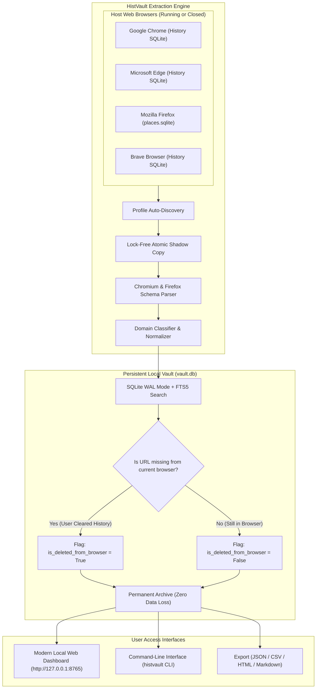

<div align="center">

# HistVault: Automated Browser History Preservation Vault
### Permanent Local History Archive with Deletion Protection, Multi-Browser Auto-Sync & Modern Web Dashboard

[](https://opensource.org/licenses/Apache-2.0)
[](https://www.python.org/)
[-brightgreen.svg)](#features)
[](#multi-browser-support)
[](#running-tests)

```
  _    _ _     _  __      __          _ _   
 | |  | (_)   | | \ \    / /         | | |  
 | |__| |_ ___| |_ \ \  / /_ _ _   _| | |_ 
 |  __  | / __| __| \ \/ / _` | | | | | __|
 | |  | | \__ \ |_   \  / (_| | |_| | | |_ 
 |_|  |_|_|___/\__|   \/ \__,_|\__,_|_|\__|
 >> AUTOMATED BROWSER HISTORY PRESERVATION VAULT <<
 >> PERMANENT ARCHIVE EVEN WHEN BROWSER HISTORY IS DELETED <<
```

**Never lose your browsing history again — even after running "Clear Browsing Data" or closing private sessions.**

</div>

---

## 🌟 Why HistVault?

Mainstream web browsers periodically purge or allow users to clear browsing history. While helpful for local privacy on shared machines, it introduces catastrophic data loss when attempting to retrace research, critical work articles, technical documentation, or forgotten bookmarks.

**HistVault** solves this by establishing a **local, self-hosted, tamper-proof history vault**. It monitors your browser history databases in real time, copies lock-free snapshots to an independent SQLite vault, and categorizes every visit.

> **💡 The Deletion Guarantee:**  
> When you delete your browsing history inside Chrome, Edge, or Firefox, **HistVault retains 100% of the data** in your local vault and clearly tags the entry as `[🔴 PRESERVED FROM DELETION]`.

---

## 🚀 Key Features

* **Anti-Deletion Preservation:** Any record purged from the browser is preserved forever in the local vault with deletion audit timestamps.
* **Lock-Free Shadow Extraction:** Bypasses SQLite database lock issues while browsers are running via atomic shadow snapshots.
* **Cross-Browser Auto-Discovery:** Works seamlessly across:
  * Google Chrome
  * Microsoft Edge
  * Brave Browser
  * Mozilla Firefox
  * Opera & Opera GX
  * Vivaldi
* **Zero Mandatory Dependencies:** Runs out of the box using pure Python standard library (`sqlite3`, `http.server`, `urllib`, `threading`, `csv`, `json`).
* **Full-Text Search (FTS5):** Instant sub-millisecond search across page titles, URLs, domains, and custom notes.
* **Built-in Modern Web Dashboard:** A responsive dark-mode glassmorphic single-page interface served on `http://127.0.0.1:8765`.
* **Automatic Domain Categorization:** Auto-tags URLs into *Development & Tech, Search & Reference, Social Media, Media & Streaming, Shopping & Finance, News, etc.*
* **Multi-Format Export Engine:** Export your entire history or just deleted entries to **JSON**, **CSV (Excel)**, **Markdown (Obsidian/Notion)**, or **Standalone Searchable HTML**.
* **Background Watcher Daemon:** Continuously polls and archives history changes without consuming CPU cycles.

---

## 🔬 How It Works



---

## ⚡ Quick Start

### Installation

```bash
git clone https://github.com/virsi18/histvault.git
cd histvault
pip install -r requirements.txt
pip install -e .
```

### 1. Windows Native Installation & Executable (.exe)

HistVault integrates directly with Windows as a true **native executable (`HistVault.exe`)** with full OS shortcut and icon customization:

#### Installing with Custom Icon:
Double-click:
👉 **`Install-HistVault.bat`**

During installation, you can select your preferred shortcut and executable icon:
* `[1]` **Apple Blue Shield** (Security Vault)
* `[2]` **Safari Compass** (Apple Web Navigation)
* `[3]` **Dark Titanium Vault** (Safe Box)
* `[4]` **Minimalist Clock** (Time & History Archive)
* `[5]` **Stealth Privacy** (Incognito Mode)
* `[6]` **Custom Icon** (Pick any `.ico` file from your PC via file browser!)

The installer automatically:
* Compiles **`HistVault.exe`** with your chosen icon embedded.
* Installs application to `%LOCALAPPDATA%\HistVault\HistVault.exe`.
* Creates a **Desktop Shortcut** with your custom icon.
* Adds a **Start Menu** folder with `HistVault` and `Change Shortcut Icon`.
* Registers into **Windows Settings > Apps > Installed apps** (and Control Panel).

#### Changing Shortcut Icon Anytime:
Want to change the icon later without reinstalling? Simply double-click:
👉 **`Change-Icon.bat`** (or via Start Menu ➜ *Change Shortcut Icon*).

#### Uninstalling (Zero-Residue History Purge):
You can uninstall through any standard Windows method:
* **Windows Settings** ➜ **Apps** ➜ **Installed apps** ➜ **HistVault** ➜ **Uninstall**, or
* **Start Menu** ➜ **HistVault** ➜ **Uninstall HistVault**, or
* Double-click **`Uninstall-HistVault.bat`**.

> **⚠️ Complete Privacy Purge Guarantee:**  
> When uninstalled, HistVault terminates all background tasks, removes all registry entries and shortcuts, and **permanently purges the entire preserved history database (`~/.histvault/vault.db`)**, leaving zero traces on your computer.

---

### 2. Launch the Native Executable (HistVault.exe)

You can launch HistVault directly as a native Windows executable:

```bash
# Double-click the compiled native executable:
HistVault.exe

# Or via Desktop Shortcut created by the installer
```

* 🖥️ **Native Window:** Embedded Edge WebView2 desktop container (1180x820 window with native close/minimize/maximize).
* 🔍 **Spotlight Search:** Instant history search across titles, URLs, and domains (`⌘K` / `Ctrl+K`).
* 🛡️ **Anti-Deletion Guarantee:** Segmented tab filter to inspect items deleted from browser history.

---

### 3. Background Auto-Preservation Service

HistVault can continuously monitor and archive history in the background without needing any open windows:

* **Start background monitoring now:** Double-click `Start-Background-Service.bat`.
* **Auto-run on Windows boot:** Double-click `Register-Windows-Startup.bat`.
* **Stop background service:** Double-click `Stop-Background-Service.bat`.

---

### 4. Launch in Web Server Mode (Alternative)

If you prefer accessing HistVault via standard web browser:

```bash
histvault serve
```
Then open: **`http://127.0.0.1:8765`**

---

### 5. Command-Line Interface (CLI)

#### Synchronize All Browsers
```bash
histvault sync
```

Output:
```text
>>> Scanning installed browsers and synchronizing history into Vault...

[SYNC COMPLETE]
 * Profiles Scanned:          5
 * New URLs Archived:         123
 * Updated URLs:              0
 * Newly Detected Deleted:    0 (Preserved in Vault!)
 * Total Records in Vault:    123
```

#### View Vault Statistics & Top Domains
```bash
histvault stats
```

Output:
```text
================ HISTVAULT STATISTICS ================
 Total Preserved History:     123 entries
 Deleted in Browser:          0 entries (100% Preserved)
 Active in Browser:           123 entries
 Total Recorded Visits:       214 visits
 Unique Domains:              17

--- Browser Breakdown ---
  * Chrome         : 106 records
  * Edge           : 17 records

--- Category Breakdown ---
  * Search & Reference       : 62 records
  * Development & Tech       : 40 records
  * General Browsing         : 21 records

--- Top Visited Domains ---
  * github.com               : 109 visits (40 URLs)
  * google.com               : 28 visits (24 URLs)
  * accounts.google.com      : 25 visits (24 URLs)
  * bing.com                 : 15 visits (10 URLs)
======================================================
```

#### Search Preserved History
```bash
histvault list -q "github" -n 10
```

#### List Only History That Was Deleted in Browser
```bash
histvault list --deleted-only
```

#### Export Your History Archive
```bash
# Export all history as an offline interactive HTML report
histvault export -f html -o report.html

# Export only deleted URLs to CSV for Excel
histvault export -f csv -o deleted_history.csv --deleted-only

# Export complete database to JSON
histvault export -f json -o backup.json

# Export to Markdown for Obsidian or Notion
histvault export -f md -o history.md
```

#### Run in Background as a Daemon
Continuously monitor browser database updates and archive changes automatically:
```bash
histvault watch --interval 30
```

---

## 💻 Python API Integration

```python
from histvault.core.database import VaultDatabase
from histvault.service.synchronizer import VaultSynchronizer
from histvault.service.exporter import HistoryExporter

# 1. Initialize local vault
db = VaultDatabase()
synchronizer = VaultSynchronizer(db)

# 2. Sync all installed browsers
report = synchronizer.sync_all()
print(f"Preserved {report.total_preserved_urls} URLs across {report.profiles_scanned} profiles.")

# 3. Query history with anti-deletion filter
deleted_items = db.search_urls(deleted_only=True)
for item in deleted_items:
    print(f"[PRESERVED DELETED] {item.browser_name} | {item.domain} | {item.title} -> {item.url}")

# 4. Export to standalone report
exporter = HistoryExporter(db)
exporter.export_html("my_history_archive.html")
```

---

## 🧪 Running Tests

The test suite runs using standard `unittest`:

```bash
python -m unittest discover tests
```

Output:
```text
.........
----------------------------------------------------------------------
Ran 9 tests in 0.143s

OK

 [TEST VERIFIED] Browser history purged, but 100% preserved in HistVault!
```

---

## 📂 Project Structure

```text
histvault/
├── histvault/
│   ├── __init__.py
│   ├── constants.py               # Cross-platform browser paths & category rules
│   ├── core/
│   │   ├── __init__.py
│   │   ├── models.py              # Data models (HistoryEntry, BrowserProfile, SyncReport)
│   │   ├── categorizer.py         # Automatic domain classifier
│   │   ├── database.py            # SQLite WAL persistent vault with FTS5 search
│   │   └── extractor.py           # Multi-browser lock-free snapshot extractor
│   ├── service/
│   │   ├── __init__.py
│   │   ├── synchronizer.py        # Multi-profile synchronization coordinator
│   │   ├── watcher.py             # Background daemon file watcher
│   │   └── exporter.py            # JSON, CSV, Markdown, Standalone HTML exporter
│   ├── server/
│   │   ├── __init__.py
│   │   ├── app.py                 # Pure standard library HTTP REST API server
│   │   └── static/
│   │       ├── index.html         # Responsive glassmorphic Web GUI dashboard
│   │       ├── style.css          # Dark slate modern styling
│   │       └── app.js             # Client controller with live search & filters
│   └── cli/
│       ├── __init__.py
│       └── main.py                # Command-line interface
├── tests/
│   ├── test_database.py           # Vault database tests
│   ├── test_categorizer.py        # Domain classifier tests
│   ├── test_exporter.py           # Multi-format export tests
│   └── test_synchronizer_deletion.py # Core deletion preservation lifecycle test
├── pyproject.toml
├── setup.py
├── requirements.txt
├── .gitignore
├── LICENSE                        # Apache License 2.0
└── README.md
```

---

## ⚖️ License

Distributed under the **Apache License, Version 2.0**. See the [LICENSE](LICENSE) file for details.

```text
Copyright 2026 HistVault Open Source Project Contributors

Licensed under the Apache License, Version 2.0 (the "License");
you may not use this file except in compliance with the License.
You may obtain a copy of the License at

    http://www.apache.org/licenses/LICENSE-2.0
```

